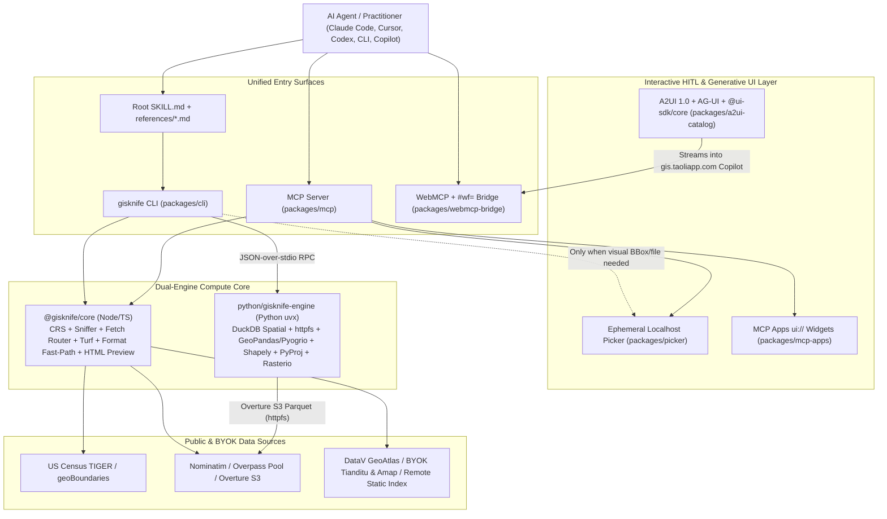

# gisknife System Architecture

> **The AI-native GIS Swiss Army Knife** — One root Agent Skill + Dual-Engine CLI (Node/TS + Python `uvx`) + MCP Apps + A2UI 1.0 + WebMCP.

## 1. Design Philosophy: "One Core, Four Surfaces, Zero Heavy Backend"

Most existing geospatial AI repositories fail everyday GIS practitioners in one of two ways:
1. **Docs-only Skills**: Pure Markdown guidelines that cannot execute transforms, fetch multi-source boundaries, or inspect files without forcing the user to manually install GDAL/QGIS/Conda.
2. **Heavy-install MCP Servers**: Monolithic Python servers dumping 90+ tool schemas into the LLM context window and failing on messy local GDAL environments.

`gisknife` solves both with four principles:
- **Thin Skill + Progressive Disclosure**: A single root [`SKILL.md`](../../SKILL.md) (< 200 lines) keeps token footprint minimal, lazily loading [`references/*.md`](../../references/) only for the active GIS workflow.
- **Dual-Engine Local Execution**: Fast path runs natively in **Node/TypeScript** (`proj4`, GCJ-02/BD-09, `@turf/turf`, `papaparse`, multi-source fetchers); heavy formats, Overture S3 Parquet, and Spatial SQL transparently dispatch over JSON-stdio RPC to **`uvx gisknife-engine`** (DuckDB Spatial, GeoPandas, PyProj, Shapely, Pyogrio, optional Rasterio/PySAL).
- **Compact-Envelope Rule (Context Window Protection)**: Spatial tools **always write full datasets to disk** and return ONLY a compact JSON envelope (`path`, `crs`, `feature_count`, `bbox`, `geometry_types`, `sample_properties`, `warnings`, `source`, `compliance_note`) to the agent.
- **Zero Heavy Backend**: All spatial computation stays on the user's machine. Interactive browser UIs (Ephemeral Picker, MCP Apps, `gis.taoliapp.com` WebMCP/WASM workbench) act purely as client-side HITL surfaces.

## 2. System Topology



## 3. Package Dependency Graph

| Package | Workspace Path | Responsibility |
|---|---|---|
| `@gisknife/core` | `packages/core` | Pure TS GIS engine: EPSG catalog (`4547`, `4526`, `4490`, full EPSG), GCJ-02/BD-09 math, coordinate sniffer, multi-source boundary & OSM router, Overpass ring stitcher, light format converters, geometry QA, Turf ops, standalone MapLibre preview generator. |
| `@gisknife/picker` | `packages/picker` | Zero-dependency ephemeral `127.0.0.1:0` HTTP server serving a self-contained MapLibre GL BBox/Polygon drawer & local file dropzone for terminal agents. |
| `@gisknife/mcp-apps` | `packages/mcp-apps` | Sandboxed `ui://` interactive HTML widgets implementing MCP Apps (`io.modelcontextprotocol/ui`) via JSON-RPC `postMessage`. |
| `@gisknife/a2ui-catalog` | `packages/a2ui-catalog` | Zod-validated A2UI 1.0 GIS Component Catalog, `@ag-ui/core` streaming event adapter, and `@ui-sdk/core` headless behavior bindings. |
| `@gisknife/webmcp-bridge` | `packages/webmcp-bridge` | The workbench's 18 existing tool descriptors, five opt-in handoff tools, and the `#wf=` URL builder. |
| `@gisknife/mcp` | `packages/mcp` | Stdio MCP server combining `@gisknife/core`, `@gisknife/mcp-apps` (`ui://` resources), and `@gisknife/picker`. |
| `gisknife` | `packages/cli` | User-facing CLI (`gisknife`, alias `gk`) + Python `uvx` subprocess bridge (`engineBridge.ts`). |
| `gisknife-engine` | `python/gisknife-engine` | Python 3.12 (`uv` / `uvx`) heavy compute engine: DuckDB Spatial + `httpfs`, GeoPandas/Pyogrio SHP (`.cpg` GBK/UTF-8 + `.zip`), GPKG, GeoParquet, FGB, DXF, `shapely.make_valid`, optional Rasterio/PySAL. |

## 4. Dual-Engine Dispatch Policy

| Task Category | Primary Engine | Why |
|---|---|---|
| Single point / DMS / WKT / CSV CRS transform + `4547`/`4526` & XY swap sniffing | Node/TS (`@gisknife/core`) | Sub-50ms cold start, zero Python spawn overhead. |
| Boundary & Overpass OSM fetch + disk caching | Node/TS (`@gisknife/core`) | Native `fetch`, multi-mirror retry/backoff, deterministic JSON summary. |
| Light text format interchange (`geojson`, `csv`, `kml`, `gpx`, `wkt`, `topojson`) | Node/TS (`@gisknife/core`) | Instant execution with zero external binary deps. |
| Heavy vector formats (`shp`/`.zip`, `gpkg`, `parquet`, `fgb`, `dxf`) | Python `uvx` (`gisknife-engine`) | Native GDAL/Pyogrio C-speed + automatic GBK `.dbf` detection & clean `.zip` packaging. |
| DuckDB Spatial SQL & Overture Maps S3 BBox extraction | Python `uvx` (`gisknife-engine`) | Native C++ `spatial` + `httpfs` extensions with predicate pushdown. |
| GeoTIFF / DEM / Band Math / PySAL Spatial Stats | Python `uvx` (`gisknife-engine[raster,stats]`) | Industrial-strength `rasterio` & `libpysal` without bloating Node installs. |

## 5. Standard Output Envelope Contract

Every command returns a consistent JSON envelope (`ResultEnvelope<T>`):

```json
{
  "ok": true,
  "command": "fetch boundary",
  "engine": "ts-core",
  "outputPath": "/path/to/nanshan_streets.geojson",
  "crs": "EPSG:4326",
  "featureCount": 8,
  "bbox": [113.88, 22.45, 114.02, 22.65],
  "geometryTypes": ["MultiPolygon"],
  "sampleProperties": ["name", "admin_level", "osm_id"],
  "source": "osm-overpass",
  "warnings": [],
  "complianceNote": "OpenStreetMap contributors (ODbL). For official China mapping/publication, use MNR Standard Maps."
}
```
