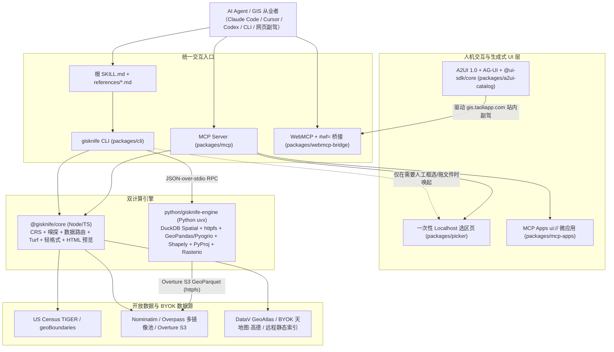

# gisknife 系统架构设计

> **面向 AI 时代的泛 GIS 瑞士军刀** —— 单入口 Agent Skill + 双引擎 CLI（Node/TS + Python `uvx`）+ MCP Apps + A2UI 1.0 + WebMCP。

## 1. 设计哲学：“一核四端，零重服务端”

市面上现有的地理空间 AI 开源项目通常落在两个极端：
1. **纯文档型 Skill**：只有 Markdown 规范，没有内置数据获取和零配置执行器，普通 GIS 从业者仍要手动折腾 GDAL/Conda/QGIS。
2. **重环境型 MCP**：把几十上百个 Python 工具定义全塞进 LLM 上下文，而且强依赖本地复杂环境。

`gisknife` 的核心解法坚持四条原则：
- **薄 Skill + 渐进披露**：根目录仅放 1 个精简 [`SKILL.md`](../../SKILL.md)（< 200 行），只在需要时按需加载 [`references/*.md`](../../references/)。
- **TS + Python `uvx` 双引擎**：高频轻量操作（点/CSV 坐标转换与 `4547`/`4526` 嗅探、多源数据拉取、轻格式互转、单文件 HTML 地图预览）全部在 Node/TS 毫秒级完成；重格式（SHP/GPKG/GeoParquet/FGB/DXF/GeoTIFF）、Overture S3 远程裁剪、DuckDB Spatial SQL 通过 JSON-stdio RPC 自动调度至 `uvx gisknife-engine`。
- **大几何不进上下文（Compact-Envelope 铁律）**：空间数据一律写盘，CLI/MCP 只返回极简 JSON 摘要（`outputPath`、`crs`、`featureCount`、`bbox`、`geometryTypes`、`sampleProperties`、`warnings`、`source`、`complianceNote`）。
- **零重服务端**：所有计算和文件均留在用户本地，浏览器只承担必要的“人机交互（框选/上传/视觉核验）”和 `gis.taoliapp.com` 高级制图交付。

## 2. 总体拓扑

## 3. Monorepo 分包职责

| 包名 | 路径 | 职责边界 |
|---|---|---|
| `@gisknife/core` | `packages/core` | 纯 TS GIS 内核：全量 EPSG + CGCS2000/GCJ-02/BD-09、智能坐标嗅探器（`4547` vs `4526` 带号错配、测绘 X/Y 轴反写）、多源边界与 OSM 路由器、Overpass Relation 闭环拼接器、轻格式互转、拓扑体检、Turf 安全算子、单文件 MapLibre 预览生成器。 |
| `@gisknife/picker` | `packages/picker` | 零常驻进程的一次性 `127.0.0.1:0` 选区服务器：支持地图框选 BBox、画多边形、本地文件拖拽上传，确认后 POST 回 CLI 并自动关闭。 |
| `@gisknife/mcp-apps` | `packages/mcp-apps` | 遵循 MCP Apps（`io.modelcontextprotocol/ui`）的沙箱 `ui://` 交互微组件（区域框选、视觉 QA 预览、4547/轴序确认面板）。 |
| `@gisknife/a2ui-catalog` | `packages/a2ui-catalog` | 面向 A2UI 1.0 的 GIS 组件目录 Schema、AG-UI（`@ag-ui/core`）流式事件桥、以及 Vercel UI SDK（`@ui-sdk/core`）无头行为适配器。 |
| `@gisknife/webmcp-bridge` | `packages/webmcp-bridge` | 与 `gis.taoliapp.com` 对齐的 18+4 个 WebMCP 工具描述符及 `#wf=` 工作台跳转构造器。 |
| `@gisknife/mcp` | `packages/mcp` | Stdio MCP 服务器，串联 `@gisknife/core`、`@gisknife/mcp-apps` 与 `@gisknife/picker`。 |
| `gisknife` | `packages/cli` | 统一命令行工具（`gisknife` / `gk`）及 Python `uvx` 调度桥（`engineBridge.ts`）。 |
| `gisknife-engine` | `python/gisknife-engine` | 基于 `uv` / Python 3.12 的重型算力引擎：DuckDB Spatial + `httpfs`、GeoPandas/Pyogrio（自动识别 SHP GBK/UTF-8 编码并打包 `.zip`）、GeoPackage、GeoParquet、FGB、DXF、`make_valid` 及可选 Rasterio/PySAL。 |

## 4. 双引擎分工策略

- **Node/TS 引擎处理**：单点/CSV 坐标转换（含 `EPSG:4547`/`4526` 带号嗅探与 X/Y 轴反写预警）、地名消歧与全球/国内多源边界拉取、Overpass 中小区域提取、`geojson/csv/kml/gpx/wkt/topojson` 互转、Turf 轻量空间运算、单文件 HTML 视觉核验。
- **Python `uvx` 引擎处理**：Shapefile（含 `.cpg` 中文编码修复）/ GeoPackage / GeoParquet / FlatGeobuf / DXF 读写、百万行级 DuckDB Spatial SQL、Overture Maps S3 远程大范围 BBox 裁剪、自动带 UTM/等面积投影的地理空间运算、以及可选 GeoTIFF 栅格（`[raster]`）与空间计量（`[stats]`）。

## 5. 与 `gis.taoliapp.com` 的协同

1. **核心代码反哺**：`@gisknife/core` 沉淀稳定后，可直接被 `gis.taoliapp.com` 引用，避免两套代码分叉。
2. **本地隐私一体**：两边均坚守“用户 GIS 数据不上传重服务端”的底线。
3. **复杂视觉交付接力**：CLI/Skill 专注自动化批处理与数据清洗；当需要交互式专业制图版面（图例/格网/PDF）、3D Cesium 地形或可视化工作流编排时，通过 `@gisknife/webmcp-bridge` 一键生成 `gis.taoliapp.com/#wf=...` 交接链接。
